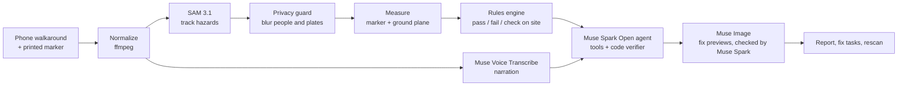

# EmberScan

**Every wildfire hazard, measured from a phone video.** Film a walkaround of a home, HOA building or commercial property, and get each hazard's distance from the wall in feet, checked against California's defensible-space rules with citations, plus a fix plan. When a measurement is too close to call, EmberScan says so instead of guessing.

A resident, HOA board member or property manager films a walkaround of a building. EmberScan:
- tracks every hazard across the video with SAM 3.1
- measures how far each hazard is from the wall
- checks each hazard against California's defensible-space rules with a deterministic rules engine, with citations

Then a Muse Spark Open agent builds a prioritized fix plan: what to do, how hard it is, a rough cost, and whose job it is. Each fix becomes a tracked task, and a rescan verifies it.

> EmberScan flags likely wildfire hazards and suggests fixes. It is not an inspection and does not certify that any property is safe or compliant.

Entry for the **Meta Global AI Developer Hackathon**: Startup track, problem statement *Build for Your World*.

- **Live app:** https://emberscan.vercel.app. Browse the finished report, or start a live scan from **New scan**. Live scans are capped per day; when the cap is reached, the form offers the sample report instead.
- **Demo video:** linked from the submission.

## Why

Most homes lost in a wildfire are lit by embers landing on what is right next to the walls: dry leaves, mulch, wood piles, shrubs. California now defines what has to be cleared in each zone around a building (0–5 ft, 5–30 ft, 30–100 ft). Insurers are dropping communities in high fire-hazard zones. But nobody on an HOA board or in a property office can measure feet from a phone photo, or read the rules that define each zone. EmberScan turns two minutes of video into a cited, measured fix list that someone can act on.

## How it works



1. **Research the address.** Adding a building runs a Muse Spark research agent. It calls tools for the US Census geocoder, CAL FIRE hazard-zone maps, recent fire perimeters and our rule reference, then writes a cited note: hazard zone, which law applies, and recent fires nearby. Code drops any fact that cites a source the agent never looked up.
2. **Film.** Lay the [printable marker](docs/filming/emberscan-scale-marker.pdf) flat on the ground against the wall and walk slowly along the building. Narration is optional ("north side, mulch bed against the wall").
3. **Track.** SAM 3.1 segments and tracks 12 hazard concepts across the whole video, such as dry leaves, mulch, shrubs, wood piles, gutter debris and overhanging branches. Scattered leaves seen together are reported as one finding that outlines every leaf. Gutter and roof hits that sit low in the frame are dropped, because they're leaves on the ground.
4. **Protect.** A privacy guard blurs every person and license plate (found by SAM 3.1 in the same pass) in every frame before any evidence or preview image is made, then deletes the raw video when the scan ends. It is code, not a model choice. It fails closed: if the check can't run, the scan keeps nothing.
5. **Measure.** The marker gives the ground plane and the scale. Each hazard gets a distance range from the wall, a confidence and a zone, and an annotated evidence frame. Ranges are given, never single numbers. A hazard that can't be measured says why. See [How measurement works](docs/how-measurement-works.md).
6. **Check.** A deterministic rules engine evaluates the California rule pack (39 rules) and returns pass, fail or "check on site" per rule, each with its citation.
   - A range that straddles a threshold is never a fail.
   - Ground the video didn't cover is "not covered, check on site", never a pass.
7. **Plan.** A fix-plan agent on **Muse Spark Open** (Meta's open-weight model, on Baseten) works through tool calls: `get_rule_results`, `list_hazards`, `get_narration`, `estimate_cost` and `submit_plan`.
   - A code verifier rejects any plan that cites unknown rules or hazards or leaves a failed rule uncovered.
   - The agent can never change a rule result.
   - Hosted Muse Spark is the fallback.
   - The whole trace is shown in the report.
8. **Preview.** For the top fixes, Muse Image edits the real (blurred) video frame to show only that fix done. Muse Spark then checks each before/after pair and drops a preview that shows no change or misrepresents the fix.
9. **Track and rescan.** Each fix becomes a task with an owner (resident, HOA or property manager), a status and dated notes. Only a rescan can mark a fix verified and change the score.

## AI previews of the fix

A fix like "clear the first 5 ft of combustibles" is abstract. EmberScan shows it on your own building, next to the frame as it is now.

- **A preview, never evidence.** It is marked on the picture itself (an "AI-generated preview" badge and a dashed frame) and in the caption. It is never measured, and the score never changes because of it.
- **Checked before it is shown.** Muse Spark compares each pair. It drops a preview that shows no change, or that pictures an inspection fix as a removal.
- **Private.** Previews are made from frames that already passed the privacy guard and never add people.
- **Useful to hand over.** Most fixes belong to someone else, such as the property manager or a landscaper. A picture of the goal is easier to pass on than a rule citation.

## Meta models used

| Model | Where | Why |
|---|---|---|
| SAM 3.1 | Vision pipeline, privacy guard | Segments and tracks hazards with stable IDs across the whole video; finds people and plates to blur |
| Muse Spark Open | Fix-plan agent (primary) | Meta's open-weight model on Baseten plans the fixes with tool calls, using the same verifier and trace ([benchmarks](docs/benchmarks.md)) |
| Muse Spark | Address research, preview check, agent fallback | Researches each address with tools; checks each AI preview shows its fix; hosted backup for the fix plan |
| Muse Voice Transcribe | Narration | Ties spoken notes to moments in the video |
| Muse Image | Fix previews | Shows what each top fix should look like, edited from your own blurred video frame |

Built with Muse Spark Open.

## Scope and limits

- **California only, for now.** The rule pack is [`docs/rules/us-ca.json`](docs/rules/us-ca.json), covering PRC 4291, Gov. Code 51182, 14 CCR 1299.03, the proposed Zone 0 rules and Board guidance. It was checked against official sources on Oct 26, 2026; see the [rules reference](docs/rules/defensible-space.md). Local ordinances aren't included. Addresses outside California are flagged on the building, the New scan form and the report.
- **Zone 0 is still proposed.** Its rules are labelled "proposed" and never count as fails. Each community can choose whether to show them.
- **Hazard-zone lookup** uses CAL FIRE / State Fire Marshal maps for the State and Local Responsibility Areas (2025). Federal land isn't mapped by the state.
- **What video can't settle**, such as vent screens, new fence materials or anything out of frame, is a "check on site" item, never a guess.
- **Other states** need their own rule pack. The engine is state-agnostic; the work is the legal research and each state's hazard-zone data.

## Built during the hackathon

Built by Jude Lee at [iiinigence](https://iiinigence.com).

Everything in this repository was created during the hackathon, **Oct 26 – Nov 4, 2026**: all code, rule packs, docs, the marker and the sample data. Nothing was imported from earlier work. The dated git history is the record, and [CHANGELOG.md](CHANGELOG.md) summarizes it day by day.

## Repository layout

| Path | What |
|---|---|
| `apps/web` | Next.js web app (mobile-first): communities, buildings, scans, reports, fix tasks, HOA view |
| `workers` | Python pipeline and worker service: video, SAM 3.1, privacy guard, measurement, rules engine, agents, previews, spend caps |
| `workers/modal_app.py` | The worker as a Modal app |
| `docs/rules` | California rules reference and the `us-ca` rule pack |
| `docs/adr` | Architecture decisions |
| `docs/contracts` | Report JSON and worker API |

## Docs

- [How measurement works](docs/how-measurement-works.md): marker, ground plane and uncertainty ranges
- [Benchmarks](docs/benchmarks.md): Muse Spark Open vs hosted Muse Spark, and EmberScan vs a vision model's guess at distance
- [Rules reference](docs/rules/defensible-space.md) and the [hazard taxonomy](docs/hazard-taxonomy.md)
- [Architecture decisions](docs/adr/README.md) and [contracts](docs/contracts/README.md)
- [Deploying](docs/deploy.md): Vercel, Modal and Neon
- [Filming guide](docs/footage-shot-list.md)

## Run it locally

Requires Node.js 24, Python 3.12 and ffmpeg. Copy [`.env.example`](.env.example) to `.env` and fill it in. Never commit `.env`.

```bash
cd workers && python -m venv .venv && .venv/bin/pip install -e ".[dev]"
.venv/bin/uvicorn emberscan_workers.service:app --port 8000
```

```bash
cd apps/web && npm ci && npm run dev
```

Without `DATABASE_URL`, the web app uses a local PGlite database seeded with a sample community; `SEED_SAMPLE=0` starts it empty.

Tests:

```bash
cd workers && .venv/bin/pytest
cd apps/web && npm test && npm run typecheck && npm run lint
```

## Cost and guardrails

A typical two-minute scan costs about $0.10–0.40 in model calls. Every run is capped by spend limits:
- a per-run limit, checked before each model call
- a separate cap for Baseten partner credits
- account-wide 24-hour and all-time caps
- a cap on how many scans run at once

An optional scan passcode (`SCAN_PASSCODE`) can gate the paid step on a public deployment.

## License

[MIT](LICENSE). Third-party licenses and required attributions are listed in [THIRD_PARTY.md](THIRD_PARTY.md).
